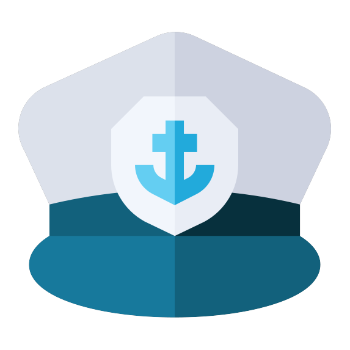

<p align="center"></p>

# Matelot — product security platform

<p></p>

Matelot (repository: `secops-platform`)

Product Security, DevSecOps & Compliance platform — delivered as **one dedicated cell per organization**,
self-hosted in the customer's Kubernetes cluster from one Helm chart (closed source; the customer gets the images and
the chart). This repository is the product: the API, the worker, the web app, the CLI, the runner agent, and the
Helm chart that turns a set of tenant values into a running cell.

> Status: **Step 1 — foundation.** Core domain (Organization → Workspace → Team → Project),
> Keycloak authentication, hierarchical RBAC, audit trail, health checks, migrations, container
> images, tenant-cell Helm chart, local kind workflow, and the web app (React + Tailwind on the
> TailAdmin template, light and dark mode).

## Architecture in one picture

```
┌─ control plane (later) ──────────────────────────────────────────────────────┐
│ customer registry · provisioning (helm upgrade --install per client)         │
│ version rollouts · licensing · fleet monitoring                              │
└───────────────┬──────────────────────────────┬───────────────────────────────┘
                │                              │
   namespace tenant-acme                namespace tenant-globex
┌────────────────────────────┐        ┌────────────────────────────┐
│ web (React, nginx)         │        │ web                        │
│ api (NestJS)  x N          │        │ api                        │
│ workers / scanner jobs (*) │        │ …                          │
│ postgres · redis           │        │ postgres · redis           │
│ keycloak (realm: platform) │        │ keycloak                   │
│ NetworkPolicy: default deny│        │                            │
└────────────────────────────┘        └────────────────────────────┘
        one Helm release                      one Helm release
```

* **Isolation between clients is physical** (namespace, database, identity realm, network policy).
* **Isolation inside a client is logical**: organizations (parent company / subsidiaries / MSSP
  customers) and hierarchical RBAC.
* **Keycloak owns authentication** (local users, SSO/SAML/OIDC brokering, MFA, later SCIM).
  **The platform owns authorization** (memberships × roles × scope hierarchy).

## Repository layout

```
apps/web/                  React 19 + TypeScript + Tailwind v4 web app (nginx in a cell, same host as the API)
  src/platform/            Our code: auth gate, API hooks, dashboard state, shared components
  src/pages/               Overview, Projects, Members, Audit trail
  src/{layout,components,context,icons}   The TailAdmin template (TypeScript), adapted
  test/render.mjs          Render smoke test: the whole app in jsdom with a fake API
  public/config.json       Runtime config (Keycloak URL, realm, API base); a ConfigMap in a cell
apps/api/                  NestJS API (one process per cell; workers come next)
  src/database/schema.ts   Drizzle schema — the single source of truth for the data model
  drizzle/                 Generated SQL migrations (committed; applied by init container)
  src/rbac/                Permissions, roles, scope resolution, guard
  src/iam/                 Users (JIT provisioning), memberships, cell bootstrap
  src/audit/               Audit trail
  test/fake-idp.js         Local stand-in for Keycloak (JWKS + token minting) for tests
deploy/helm/secops-cell/   The tenant cell chart (API + Postgres + Redis + Keycloak + policies)
deploy/kind/               Local cluster config
deploy/keycloak/           Dev realm for docker compose
scripts/                   kind-up, token, smoke
docs/adr/                  Architecture decision records
```

## Running it locally (no Kubernetes)

Prerequisites: Node 22, pnpm 9 (`corepack enable`), Docker.

```bash
cp .env.example .env
make install          # pnpm install
make dev-infra        # Postgres 16, Redis 7, Keycloak 26 (realm "platform" imported, users admin/admin, dev/dev)
make migrate          # applies apps/api/drizzle/*.sql
make dev              # API on http://localhost:3000, OpenAPI UI on /api/docs
make web              # web app on http://localhost:5173 (proxies /api to the API) — sign in as admin / admin
make smoke            # logs in as admin@acme.local, creates workspace/team/project, prints the audit trail
```

The web app signs in through Keycloak's `platform-web` client (authorization code + PKCE) and calls
the API with the resulting access token; the API validates it exactly as it does for any other
client. Runtime settings come from `/config.json`, so one image serves every cell.

Getting a token by hand:

```bash
TOKEN=$(scripts/token.sh)                  # admin@acme.local
curl -H "Authorization: Bearer $TOKEN" localhost:3000/api/v1/me
```

## Running it as a tenant cell (kind)

Prerequisites: kind, kubectl, helm, Docker.

```bash
make kind-up                                   # cluster "secops" + ingress-nginx
echo "127.0.0.1 acme.platform.local auth-acme.platform.local" | sudo tee -a /etc/hosts
make kind-load                                 # build image, load into kind
make deploy TENANT=acme                        # helm upgrade --install acme … -n tenant-acme
kubectl -n tenant-acme get pods -w             # keycloak takes ~1–2 min the first time
API=http://acme.platform.local/api/v1 KC=http://auth-acme.platform.local make smoke
```

Deploying a second client is the same command with a different slug — that *is* the provisioning
model the control plane will automate later:

```bash
echo "127.0.0.1 globex.platform.local auth-globex.platform.local" | sudo tee -a /etc/hosts
make deploy TENANT=globex TENANT_NAME="Globex Corporation"
```

See `deploy/helm/secops-cell/values.yaml` for every knob and `values-production.example.yaml`
for a cell with external Postgres/Redis and TLS.

## Releases, public repositories and the website

Matelot is closed source and self-hosted: customers get the images and the chart, nothing else leaves this
repository. The GitHub organization `matelot-cloud` has this private monorepo (`platform`) and four public repositories:

| Repository | What | Updated by |
| --- | --- | --- |
| `matelot-cloud/matelot` | issues, discussions, releases, EULA, security policy, changelog summary | people; releases by the pipeline |
| `matelot-cloud/helm-charts` | `charts/secops-cell` + backup/restore scripts (copies of `deploy/helm/secops-cell`, `scripts/cell-*.sh`) | the release pipeline |
| `matelot-cloud/website` | landing page (its own `content.json`) + generated docs (`docs/latest`, `docs/vX.Y`), GitHub Pages | docs by the pipeline, landing by people |
| `matelot-cloud/.github` | organization profile and default community files | people |

Images: `ghcr.io/matelot-cloud/{api,web,worker,runner}`; chart: `oci://ghcr.io/matelot-cloud/charts/secops-cell`.

* **A tag `vX.Y.Z` releases everything** (`.github/workflows/release.yml`): multi-arch images signed with cosign and
  carrying syft SBOM attestations, the chart as OCI, the chart folder and scripts synced to `helm-charts`, the docs
  rendered into `website` (`docs/vX.Y/` + `latest`), and a GitHub Release in `matelot` with the `CHANGELOG.md`
  section and the digests. Every push to `main` syncs `docs/latest` (`docs-sync.yml`). Cross-repository pushes use
  the organization secret `PUBLIC_REPOS_TOKEN`; the whole procedure, the one-time setup and the token rotation are in
  **docs/release-process.md** (internal, not published).
* **Documentation** is `docs/*.md` rendered by `tools/docs-site/build.mjs` (page list: its `SITE` table; the install
  guide for customers is `docs/install.md`). `make docs-check` renders and link-checks it (CI); `make docs-sync
  WEBSITE_DIR=../website` renders into a local clone of the website to preview the whole site.
* Inside a cell, the sidebar's "Documentation" opens the public site; `web.docsUrl` in the chart (or `docsUrl` in
  `config.json`) points an air-gapped cell at a mirror.

## The web app

The UI is built on **TailAdmin React** (MIT): React 19, TypeScript and Tailwind CSS v4, with the
template's sidebar, header, light/dark theme and UI primitives (cards, tables, badges, modals,
inputs). Everything of ours lives under `src/platform` and `src/pages`; the template files were
adapted rather than rewritten (sidebar menu, header controls, user menu, brand). Sections that
arrive in later steps (Vulnerabilities, SBOM, Policies, Compliance) are already in the sidebar,
muted with a "soon" badge. The header carries the organization switcher (shown when you can see
more than one), the refresh interval every section follows, and the dark-mode toggle.

`pnpm --filter @secops/web test` mounts the real app in jsdom through Vite — layout, router,
pages and hooks — with sign-in stubbed and the API faked, and checks each page shows its data.
It runs in CI; it is not a substitute for opening the app, but it catches wiring mistakes.

| Section     | Shows                                                                    |
| ----------- | ------------------------------------------------------------------------ |
| Overview    | Organization facts, structure counts, your roles, projects by criticality, recent activity |
| Projects    | Workspaces → teams → projects with create dialogs, project details, archive |
| Members     | Who holds which role at any scope; grant by email, remove                |
| Audit trail | Every recorded event with before/after and request id; paged, filterable |

Every list respects RBAC: a project-scoped developer sees the path to their project and nothing
else, and cards they may not read say so instead of erroring.

## The domain model

| Concept       | Notes                                                                                 |
| ------------- | ------------------------------------------------------------------------------------- |
| Organization  | Root org created by cell bootstrap. Child orgs model subsidiaries / MSSP customers.   |
| Workspace     | Business unit or product line inside an organization.                                 |
| Team          | Owns projects; the unit developers belong to.                                         |
| Project       | A product/system with a business **criticality** (input to the risk engine).          |
| User          | Provisioned just-in-time from the Keycloak token; can be invited by email beforehand. |
| Membership    | `user × role × scope` — the one RBAC primitive.                                        |
| AuditEvent    | Who / what / when / before / after / why / request id — for every mutation.           |

Service and Environment (below Project) arrive with the GitHub integration in step 2.

## Access control: two levels, GitLab-style

**Cell level:** every user is a *user* or an *administrator*. Administrators see and can do everything
and have the Administration area (Users; later integrations, runners, settings); they can disable a
user. Bootstrap emails become administrators. **Scoped level:** the roles below, granted at
organization / workspace / team / project / service / environment (see ADR 0003).

## Scoped roles in three rules

1. **A role at a scope applies to that scope and everything below it.** ORG_ADMIN on the
   organization is ORG_ADMIN everywhere in it; DEVELOPER on one project is a developer there only.
   Parent-organization roles apply inside subsidiaries.
2. **Permissions never flow upwards.** A project developer cannot write to the team, read the
   organization's audit trail, or grant roles.
3. **You can always see the path to what you own.** A project developer can list the organization,
   workspace and team that contain their project (and nothing else at those levels), so navigation
   works without granting anything.

Roles: ORG_ADMIN, SECURITY_ADMIN, COMPLIANCE_OFFICER, CISO, CTO, TEAM_LEAD,
PRODUCT_SECURITY_ENGINEER, DEVELOPER, AUDITOR, EXTERNAL_CONSULTANT, READ_ONLY.
The role → permission matrix lives in `apps/api/src/rbac/permissions.ts` and is unit-tested in
`authorization.service.spec.ts`. Permissions for later domains (vulnerabilities, policies,
compliance, evidence, risk, incidents) are already declared so the matrix is complete from day one.

Routes declare what they need:

```ts
@Patch('projects/:projectId')
@RequirePermission('project:write')
update(@CurrentUser() user, @Scope() chain: ScopeChain, @Body() dto: UpdateProjectDto) { … }
```

The guard resolves `:projectId` to its team → workspace → organization chain (rejecting URLs whose
nested ids don't belong together), loads the caller's memberships once per request, and checks the
union of their roles' permissions along the chain.

## Cell bootstrap (no seeding step)

Each cell is configured with `BOOTSTRAP_ORG_SLUG`, `BOOTSTRAP_ORG_NAME` and
`BOOTSTRAP_ADMIN_EMAILS` (Helm: `tenant.slug`, `tenant.name`, `tenant.adminEmails`). On startup the
API creates the root organization if missing; the first login of a listed email receives
ORG_ADMIN on it. Both actions are written to the audit trail with actor `SYSTEM`.

## API surface (step 1)

```
GET    /api/v1/me
GET    /api/v1/meta                               roles, scope types, criticalities, permission matrix, cell identity
GET    /api/v1/organizations                      visible organizations
POST   /api/v1/organizations                      create a child organization (parentId required)
GET    /api/v1/organizations/:id                  PATCH …/:id
GET    /api/v1/organizations/:id/workspaces       POST …/workspaces
GET    /api/v1/organizations/:id/teams            all visible teams in the org (with workspace)
GET    /api/v1/organizations/:id/projects         all visible projects in the org (with team, workspace)
GET    /api/v1/workspaces/:id                     PATCH, DELETE (archive)
GET    /api/v1/workspaces/:id/teams               POST …/teams
GET    /api/v1/teams/:id                          PATCH, DELETE
GET    /api/v1/teams/:id/projects                 POST …/projects
GET    /api/v1/projects/:id                       PATCH, DELETE
GET    /api/v1/memberships?scopeType=&scopeId=    POST /memberships   DELETE /memberships/:id
GET    /api/v1/organizations/:id/audit-events
GET    /api/v1/health/live   /api/v1/health/ready  (public)
```

OpenAPI: `/api/docs` (UI) and `/api/docs-json`.

## Working on the schema

```bash
# edit apps/api/src/database/schema.ts, then:
pnpm db:generate            # writes apps/api/drizzle/000N_<name>.sql + meta/000N_snapshot.json + journal — commit all three
make migrate                # apply locally
```

CI runs `drizzle-kit generate` and fails unless it is a no-op, so a schema change always ships with its snapshot.
Hand-written SQL (data migrations, partial indexes) still needs `schema.ts` to match and a regenerated snapshot:
`scripts/regen-snapshot.sh` after writing the SQL.

In Kubernetes the API pod's init container applies migrations before the app starts, so a
rollout of a new image version carries its schema changes with it.

## Endpoints

A deployed cell has three hostnames — app+API, registry, auth — see `docs/endpoints.md`.

## CI/CD integration

Pipelines use signed CI tokens through the `secops` CLI (npm `matelot-cli`, source `apps/cli`); see `docs/ci-integration.md`.

## Roadmap

**v1 focus:** `docs/concept-v1.md` + `docs/roadmap/v1.md` (milestones M1–M12, status). Seventeen steps, one document each, with a matrix mapping every section of the product concept to
its step: `docs/roadmap/README.md`. Step 01 is done; step 02 is in progress.

## Conventions

* NestJS 11 line (pinned deliberately; upgrade to 12 is a separate change). Drizzle ORM with
  hand-reviewable SQL migrations. Zod-validated environment. Structured JSON logs (pino) with
  `x-request-id` correlation that is also stored on every audit event.
* Every mutation goes through a service that writes an audit event. Controllers never touch the DB.
* Slugs are immutable identifiers; names are editable. Deletes are archives.
